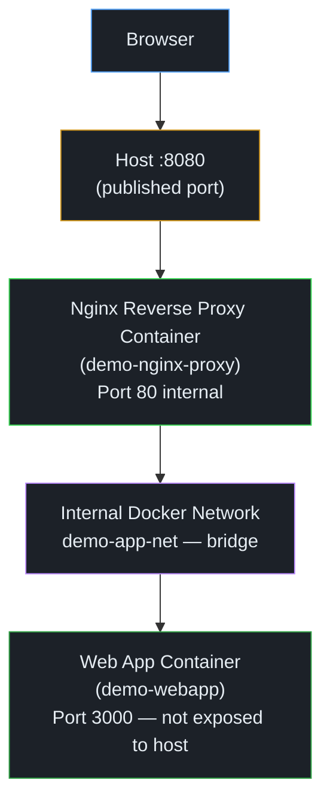

# Dockerized Web Application Deployment with Nginx Reverse Proxy

> **Portfolio project** demonstrating Docker, Docker Compose, and Nginx
> reverse proxy patterns for freelance DevOps engagements.

---

## Table of Contents

1. [Project Overview](#1-project-overview)
2. [Problem This Solves](#2-problem-this-solves)
3. [Architecture](#3-architecture)
4. [Technology Stack](#4-technology-stack)
5. [Repository Structure](#5-repository-structure)
6. [Prerequisites](#6-prerequisites)
7. [Installation and Quick Start](#7-installation-and-quick-start)
8. [Verify in a Browser](#8-verify-in-a-browser)
9. [Running Automated Tests](#9-running-automated-tests)
10. [Troubleshooting Commands](#10-troubleshooting-commands)
11. [Common Issues and Fixes](#11-common-issues-and-fixes)
12. [Viewing Container Logs](#12-viewing-container-logs)
13. [Restart or Stop the Project](#13-restart-or-stop-the-project)
14. [Security Considerations and Known Limitations](#14-security-considerations-and-known-limitations)
15. [Future Improvements](#15-future-improvements)
16. [Portfolio Summary](#16-portfolio-summary)

---

## 1. Project Overview

This project packages a lightweight web application and its Nginx reverse proxy
into two separate Docker containers, orchestrated with Docker Compose. The
primary goal is to demonstrate the deployment patterns used in real client
engagements:

- Isolating application code from infrastructure configuration
- Routing all external traffic through a single, controlled entry point
- Using Docker Compose for reproducible, one-command deployments
- Validating the deployment automatically with a Python test suite

The application itself is an original HTML/CSS/JavaScript landing page served
by an Nginx static-file server. The choice of a static site keeps the demo
lightweight and free of runtime language dependencies — the focus is the
infrastructure, not the application logic.

---

## 2. Problem This Solves

A common client request is: *"I have a web application; can you containerize it
and put Nginx in front of it?"*

This project demonstrates the complete solution:

| Client need | Implementation |
|-------------|----------------|
| Application runs in a container | `webapp` service using `nginx:1.27-alpine` |
| Application port not exposed to internet | No `ports:` mapping on the `webapp` service |
| Single entry point (Nginx) | `nginx` service published on host port 8080 |
| Containers communicate securely | Dedicated internal bridge network `demo-app-net` |
| Services recover from crashes | `restart: unless-stopped` policy on both services |
| Deployment is repeatable | `compose.yaml` + `.env.example` + `scripts/deploy.sh` |
| Deployment can be verified | `tests/test_deployment.py` test suite |

---

## 3. Architecture



**Why this design?**

- **The app port (3000) is internal** because direct access to the application
  would bypass the proxy and all the HTTP headers, logging, and error handling
  it provides. Keeping it internal also means only Nginx needs to be secured,
  rate-limited, and exposed — the application code has a smaller attack surface.
- **Nginx is the public entry point** so we can add TLS termination, rate
  limiting, caching, and routing rules in one place without changing the
  application container at all.
- **Service-name routing (`webapp:3000`)** means container IPs can change on
  restart without breaking the configuration. Docker's embedded DNS resolves
  Compose service names automatically within a user-defined network.

---

## 4. Technology Stack

| Technology | Version | Role |
|-----------|---------|------|
| Docker | 29+ | Container runtime |
| Docker Compose | v2 | Multi-container orchestration |
| Nginx | 1.27-alpine | Reverse proxy and static file server |
| HTML / CSS / JS | — | Demo application (no framework) |
| Python | 3.8+ | Automated test suite (stdlib only) |
| Bash | — | Operational scripts |

---

## 5. Repository Structure

```
docker-nginx-deployment/
├── app/
│   ├── Dockerfile          # Application container image
│   ├── nginx-app.conf      # Inner Nginx config (serves static files on :3000)
│   ├── index.html          # Demo landing page
│   └── assets/
│       ├── style.css       # Page stylesheet
│       └── app.js          # Minimal runtime JS (health badge)
├── nginx/
│   └── default.conf        # Reverse proxy configuration
├── tests/
│   └── test_deployment.py  # Automated test suite (stdlib only)
├── scripts/
│   ├── deploy.sh           # Build images and start the stack
│   ├── test.sh             # Run the test suite
│   └── cleanup.sh          # Stop containers and remove the network
├── Dockerfile.nginx        # Reverse proxy container image
├── compose.yaml            # Docker Compose service definitions
├── .env.example            # Safe example environment variables
├── .gitignore              # Excludes .env, certs, caches, etc.
├── README.md               # This file
├── SECURITY.md             # Security policy and known limitations
└── LICENSE                 # MIT
```

---

## 6. Prerequisites

| Requirement | Minimum version | Check |
|-------------|----------------|-------|
| Docker Engine | 24.0 | `docker --version` |
| Docker Compose plugin | v2.20 | `docker compose version` |
| Python | 3.8 | `python3 --version` *(tests only)* |
| Bash | 3.2 | `bash --version` |
| Free port | 8080 | `lsof -i :8080` |

> **macOS users:** Install [Docker Desktop](https://www.docker.com/products/docker-desktop/)
> which includes both Docker Engine and the Compose plugin.

---

## 7. Installation and Quick Start

```bash
# 1. Clone the repository
git clone https://github.com/YOUR_USERNAME/docker-nginx-deployment.git
cd docker-nginx-deployment

# 2. Create .env from the example (review and adjust if needed)
cp .env.example .env

# 3. Build images and start the stack
bash scripts/deploy.sh
```

The deploy script will:
1. Validate your Compose configuration.
2. Build the two Docker images.
3. Start both containers in detached mode.
4. Wait up to 90 seconds for health checks to pass.
5. Print the application URL.

**Manual alternative** (without the deploy script):

```bash
cp .env.example .env
docker compose build
docker compose up --detach
docker compose ps   # confirm both services are running
```

---

## 8. Verify in a Browser

Once the stack is running, open:

```
http://localhost:8080/
```

You should see the deployment demo landing page. The status badge in the hero
section will show **Application Running** when the `/healthz` endpoint responds
successfully.

To verify the health endpoint directly:

```bash
curl http://localhost:8080/healthz
# Expected output: ok
```

To confirm Nginx is correctly forwarding requests to the app container, check
the response headers:

```bash
curl -I http://localhost:8080/
# Look for: Server: nginx
```

---

## 9. Running Automated Tests

```bash
bash scripts/test.sh
```

Or run the Python file directly:

```bash
python3 tests/test_deployment.py
```

The test suite is grouped into four sections:

| Group | Tests | Requires |
|-------|-------|----------|
| **Static checks** | Compose config valid, shell syntax, Python syntax, required files exist | Nothing — always runs |
| **Docker state** | Containers healthy, webapp has no published host ports | Docker daemon |
| **HTTP tests** | GET / returns 200, page content, /healthz, app port NOT open on host | Stack running |
| **Nginx config in container** | `nginx -t` passes | Stack running |

**Environment variables for tests:**

```bash
NGINX_PORT=8080       # Host port to test (default: 8080)
HEALTH_TIMEOUT=60     # Seconds to wait for healthy state (default: 60)
```

**Exit codes:** `0` = all executed tests passed, `1` = one or more failures.
Skipped tests (stack not running) do not cause a non-zero exit.

---

## 10. Troubleshooting Commands

```bash
# Overall container status
docker compose ps

# Is the application healthy?
docker inspect --format '{{.State.Health.Status}}' demo-webapp
docker inspect --format '{{.State.Health.Status}}' demo-nginx-proxy

# Check published ports (webapp should show nothing)
docker inspect --format '{{json .NetworkSettings.Ports}}' demo-webapp
docker inspect --format '{{json .NetworkSettings.Ports}}' demo-nginx-proxy

# Confirm containers are on the right network
docker network inspect demo-app-net

# Validate Nginx config inside the proxy container
docker exec demo-nginx-proxy nginx -t

# Reload Nginx config without restarting the container
docker exec demo-nginx-proxy nginx -s reload

# Check if port 8080 is listening
lsof -i :8080            # macOS/Linux
netstat -an | grep 8080  # alternative

# Hit health endpoint
curl http://localhost:8080/healthz

# Hit main page
curl -s http://localhost:8080/ | grep -i "docker"
```

---

## 11. Common Issues and Fixes

### Port 8080 is already in use

```bash
# Find the process using the port
lsof -i :8080

# Option A: Stop the conflicting process
# Option B: Change NGINX_PORT in .env and redeploy
#   echo "NGINX_PORT=8081" > .env
#   docker compose down && docker compose up --detach
```

### Container exits immediately after starting

```bash
# Check the logs for the failing container
docker compose logs webapp
docker compose logs nginx
```

Common causes: port conflict, Nginx config syntax error, missing file in the
image. Fix the underlying issue, then `docker compose up --detach --build`.

### `docker compose build` fails: "file not found"

Ensure you are running commands from the project root directory
(`docker-nginx-deployment/`), not from a subdirectory.

### Health check stuck in "starting" state

Health checks have a `start_period` before they start counting failures. Wait
up to 20 seconds after `docker compose up` before expecting `healthy`. If a
container stays in `starting` for more than 60 seconds, check its logs.

### Cannot connect to `localhost:8080`

1. Confirm the stack is running: `docker compose ps`
2. Confirm the port mapping: `docker port demo-nginx-proxy`
3. If `NGINX_PORT` was changed in `.env`, use that port instead of 8080.

---

## 12. Viewing Container Logs

```bash
# All services, follow
docker compose logs -f

# Single service
docker compose logs -f nginx
docker compose logs -f webapp

# Last 50 lines from both services
docker compose logs --tail=50

# Access log only (Nginx proxy container)
docker exec demo-nginx-proxy cat /var/log/nginx/access.log

# Error log only
docker exec demo-nginx-proxy cat /var/log/nginx/error.log
```

---

## 13. Restart or Stop the Project

```bash
# Restart all services
docker compose restart

# Restart one service
docker compose restart nginx

# Stop (keep containers)
docker compose stop

# Stop and remove containers + network (keep images)
bash scripts/cleanup.sh

# Stop, remove containers, network, AND images built by this project
docker compose down --rmi local
```

---

## 14. Security Considerations and Known Limitations

Please read [`SECURITY.md`](SECURITY.md) for the full security policy.

**Key points:**

- **HTTP only.** HTTPS is not configured. Do not expose this stack to the public
  internet without adding TLS termination.
- **No authentication.** The `/healthz` endpoint and all pages are publicly
  accessible.
- **Static demo only.** There is no backend logic, database, or user data.
- **Resource limits not set.** Add `mem_limit` / `cpus` in Compose for
  production use.
- **Health endpoint scope.** `/healthz` confirms the Nginx proxy container is
  alive — it does not check database connectivity or external services.

---

## 15. Future Improvements

> These features are **not currently implemented**. They are listed to show how
> this project would evolve toward a production deployment.

- [ ] **HTTPS with Let's Encrypt** — Add Certbot sidecar or Traefik for
      automatic TLS certificate issuance and renewal.
- [ ] **Nginx rate limiting** — `limit_req_zone` to protect against brute-force
      and DDoS.
- [ ] **Read-only container filesystems** — Mount Nginx temp dirs as `tmpfs` and
      set `read_only: true` on the service.
- [ ] **Resource limits** — Add `deploy.resources.limits` (mem, CPU) to prevent
      a runaway container from starving the host.
- [ ] **CI/CD pipeline** — GitHub Actions workflow to build, test, and push
      images on every push.
- [ ] **Docker secrets** — Move sensitive environment variables out of `.env`
      and into Docker secrets or a secrets manager (Vault, AWS Secrets Manager).
- [ ] **Centralised logging** — Forward container logs to Loki, ELK, or
      CloudWatch.
- [ ] **Reverse-proxy caching** — Add `proxy_cache` to Nginx for static assets.
- [ ] **Container scanning** — Add Trivy or Grype to the CI pipeline to scan
      images for CVEs.

---

## 16. Portfolio Summary

> Use this text directly in your Upwork profile or proposal.

---

**Project: Dockerized Web Application with Nginx Reverse Proxy**

Built a fully containerized web application deployment that demonstrates the
patterns I apply daily in client engagements:

- **Two-container architecture**: a public-facing Nginx reverse proxy and an
  isolated application container that is never exposed directly to the internet.
- **Docker Compose orchestration**: single-command deployment with environment
  variable support, restart policies, and Docker health checks on both services.
- **Production-conscious Nginx configuration**: upstream block with Compose
  service-name routing, forwarded HTTP headers (X-Real-IP, X-Forwarded-For),
  configurable timeouts, a dedicated `/healthz` endpoint, and a graceful 503
  response when the upstream is unreachable.
- **Automated validation**: Python test suite (stdlib only) that verifies the
  HTTP response, page content, health endpoint, app port isolation, and
  container health state.
- **Safe operational scripts**: `deploy.sh`, `test.sh`, and `cleanup.sh` with
  error handling, no global `docker system prune`, and no sudo.
- **Security hygiene**: Linux capabilities dropped to minimum, no privileged
  mode, `.env` excluded from Git, base images pinned.

**Technologies**: Docker · Docker Compose · Nginx · Linux · Bash · Python ·
HTML/CSS/JS

**Repository**: [github.com/YOUR_USERNAME/docker-nginx-deployment](https://github.com)

---

